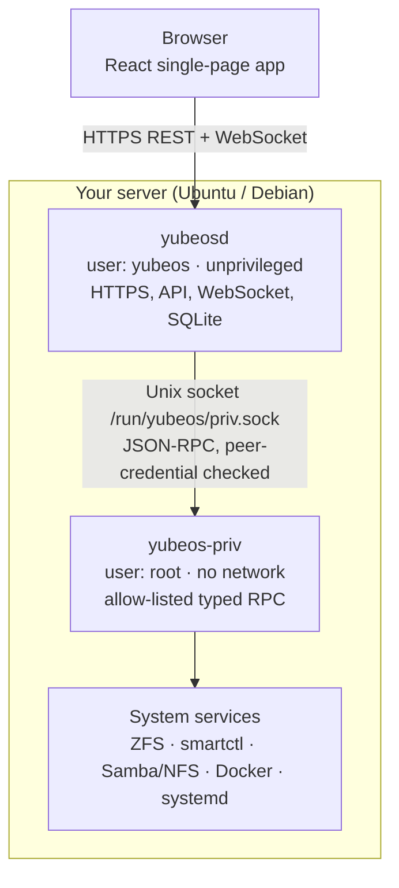
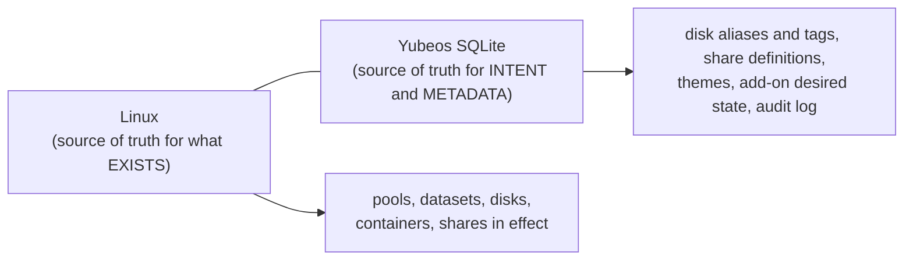
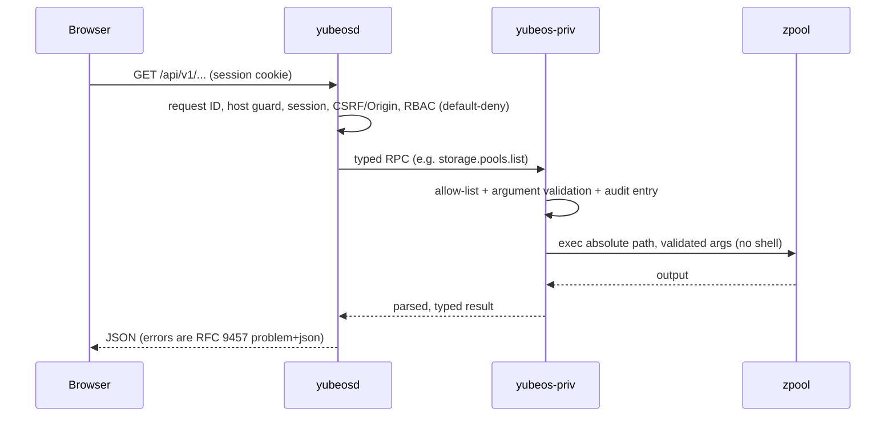

# 1. How it works

Yubeos is a **control plane**: a web interface and API that orchestrate software already on your Linux machine (OpenZFS, Samba, NFS, Docker, `smartctl`, systemd). It does not replace any of them. If you can see a pool in `zpool status`, you see the same pool in Yubeos.

## 1.1 The big picture



| Piece | What it is | Why it is separate |
|---|---|---|
| `yubeosd` | The only network-facing process. Serves the web UI (embedded in the binary), the REST API and WebSockets. Keeps intent and metadata in SQLite. | It runs without privileges, so a bug in request handling cannot touch disks or credentials directly. |
| `yubeos-priv` | A small root helper reachable only through a local socket. Exposes *named operations* (e.g. “list pools”), never “run this command”. Owns the credential store. | A tiny, audited privilege boundary instead of a root web server. |
| Metrics collector | Runs inside `yubeosd`: reads `/proc`, `/sys` and `nvidia-smi` every second (and CPU power through the helper), keeps an hour in memory and per-minute history in SQLite, and streams live frames over a WebSocket. | One source per provider, so a failing sensor degrades one card only. |
| `yubeosctl` | Local command-line tool for admins: status, diagnostics, user bootstrap and recovery. | Recovery must work even when nobody can log in. |
| Web UI | A React app generated against the same OpenAPI contract the server implements. | Contract-first: UI and server cannot drift silently. |

## 1.2 Who owns which data



Yubeos never hides state that the native tools would show you, and it only edits configuration files it owns (for example a dedicated Samba include file).

## 1.3 Anatomy of a request



Key properties:

- **Default-deny:** an endpoint is unreachable unless it declares who may call it.
- **No shell strings:** helpers execute fixed binaries with validated arguments.
- **Every state-changing call is audited.**
- **Providers have mocks:** each hardware integration (ZFS, GPU, SMART…) has a real and a mock implementation, which is what powers demo mode.

## 1.4 Demo mode versus real mode

| | Demo (`--demo`) ✅ | Real 🟦 |
|---|---|---|
| Hardware | Deterministic mock data | Real disks, pools, GPUs |
| Authentication | None (fake admin) — **development only** | Native credentials + 2FA |
| Privileges | Not needed, runs as your user | `yubeosd` + `yubeos-priv` under systemd |
| TLS | Self-signed (auto-generated) | Self-signed, your files, or ACME |
| Use for | Building and trying the UI | Your actual server |

Outside demo mode the current build refuses unauthenticated API access (HTTP 401) because the authentication spine is default-deny.

## 1.5 Repository map

```text
cmd/yubeosd/      daemon entry point (flags, config, TLS, graceful shutdown)
internal/api/     HTTP server, middleware, auth spine, system info
internal/config/  config loading, validation, env overrides
internal/tlsutil/ self-signed certificate management
api/openapi.yaml  the API contract
schemas/          JSON Schemas (config, theme, add-on manifest)
web/              React + TypeScript UI, embedded into the binary
docs/             reference docs, module specs, ADRs, this tutorial
```

Next: [2. Try the demo](02-try-the-demo.md).
