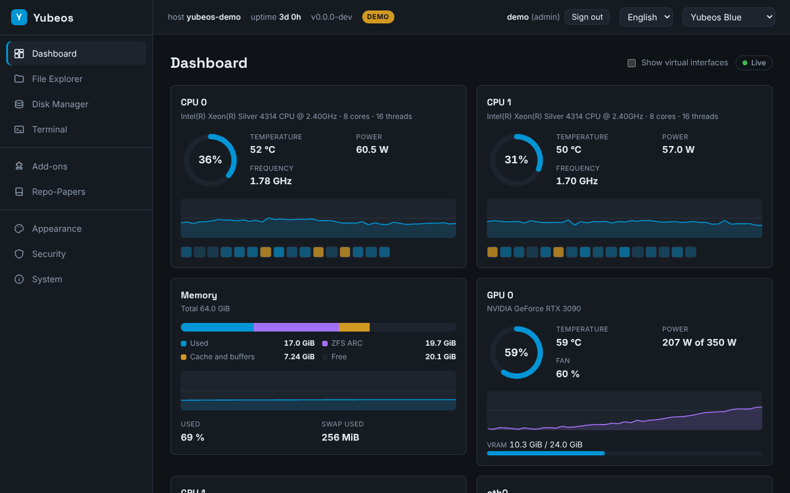
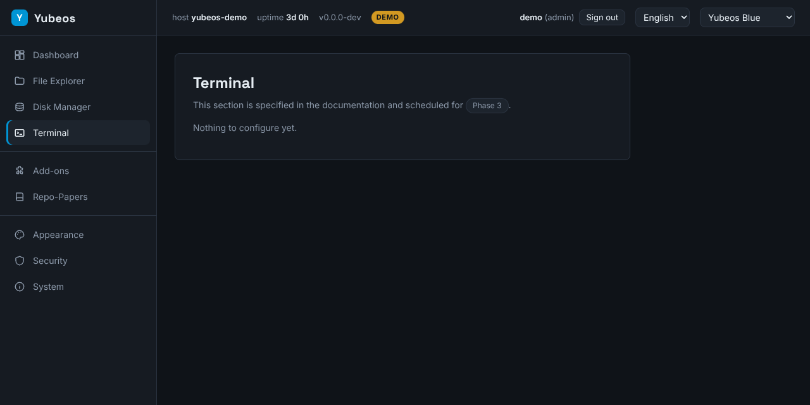
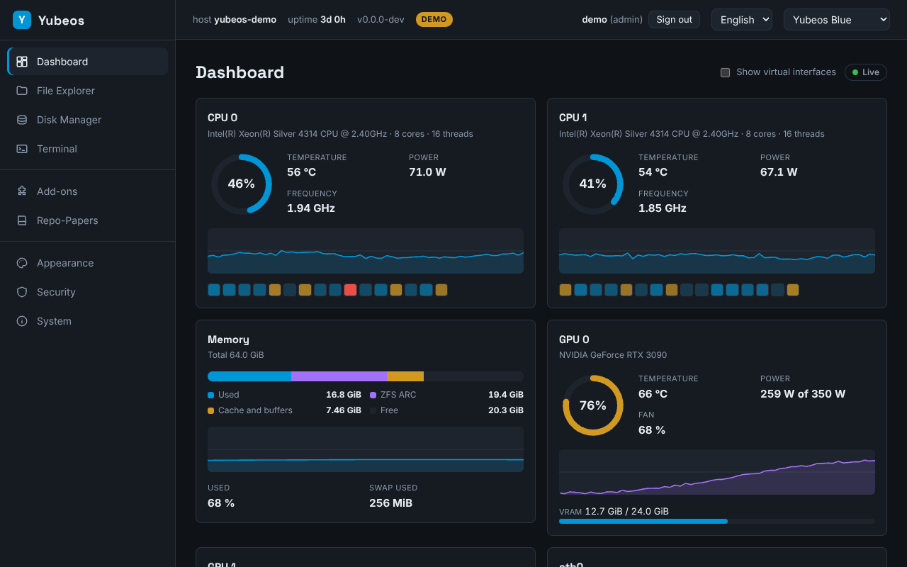
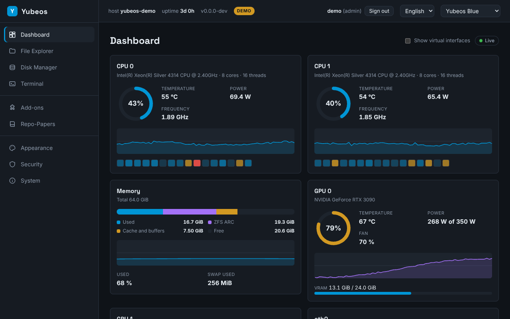
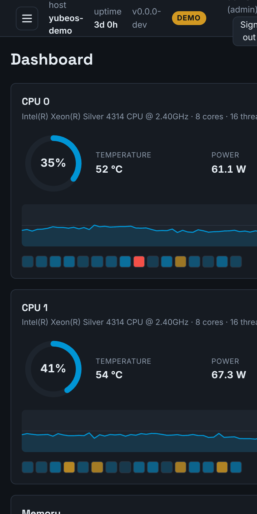

# 2. Try the demo ✅

Demo mode runs the full shell with mock hardware on any Linux machine or WSL2. No root, ZFS, GPU or Docker is needed.

## 2.1 Requirements

Go ≥ 1.26 (see `go.mod`), Node.js ≥ 22, `make`, `git`.

## 2.2 Run it

```bash
git clone https://github.com/serpis172/Yubeos && cd Yubeos
make deps        # go mod download + npm ci
make demo        # builds the UI, then serves https://localhost:8443
```

Open <https://localhost:8443> and accept the self-signed certificate warning (the certificate is generated on first start and reused afterwards). Demo mode only listens on loopback unless you pass `--allow-demo-public`.

> **Demo has no authentication.** It is for development only; never expose a demo instance.

## 2.3 Tour of the shell



1. **Sidebar** — the sections, grouped as in the original design sketch: core (Dashboard, File Explorer, Disk Manager, Terminal), ecosystem (Add-ons, Repo-Papers) and settings (Appearance, Security, System). Installed add-ons will appear as extra entries once Phase 7 lands.
2. **Top bar** — hostname, uptime and version (read live from `GET /api/v1/system/info`), the amber **DEMO** badge, the signed-in user with **Sign out**, and the **language** (English / Italiano) and **theme** pickers.
3. **Content area** — the **Dashboard** is live (next section); the sections still to be built show a placeholder naming the phase that delivers them.



Terminal, File Explorer, Disk Manager, Add-ons, Repo-Papers and System are **placeholders in this snapshot**; their designs are in the [module specs](../modules/). The shell, navigation, theming, Dashboard, Appearance and Security are real.

## 2.3b The live Dashboard

In demo mode the Dashboard shows a deterministic fake server (2 CPU sockets, 64 GiB RAM with a ZFS ARC, 2 GPUs, 3 network interfaces, 4 disks). The same `--demo-seed` always produces the same data:

```bash
yubeosd --demo --demo-seed 7        # a different, but reproducible, machine
```

See [chapter 5](05-sections-tour.md#dashboard) for what each card shows.

## 2.4 Themes

Three built-in themes ship, selectable from the top bar and remembered in the browser; you can also build your own in **Appearance** ([chapter 5](05-sections-tour.md#appearance)). All colours come from design tokens (`--y-*`), so themes can be restyled without touching components (see [Appearance](../modules/appearance.md)).

| Yubeos Blue (default) | Yubeos Light | Yubeos Midnight |
|---|---|---|
|  |  |  |

## 2.5 Mobile layout



## 2.6 Poke the API

```bash
curl -sk https://localhost:8443/healthz
# {"ok":true}

curl -sk https://localhost:8443/api/v1/system/info
# {"hostname":"yubeos-demo","version":"0.0.0-dev","demoMode":true,"uptimeSeconds":…,
#  "os":{…},"capabilities":{"docker":true,"zfs":true,"smart":true,…}}

curl -sk https://localhost:8443/api/v1/metrics/snapshot | head -c 300
# {"stale":[],"t":…,"values":{"cpu.0.freq":1.84e9,"cpu.0.power":64.9,"cpu.0.temp":53.3,"cpu.0.util":40.2,…
```

`capabilities` tells the UI which sections to enable; on a machine without ZFS or Docker the matching screens show a “capability missing” state instead of failing. Errors follow [RFC 9457](https://www.rfc-editor.org/rfc/rfc9457) `application/problem+json`. The full contract is [`api/openapi.yaml`](../../api/openapi.yaml), summarised in [API](../API.md).

## 2.7 Fast UI development loop

```bash
# terminal 1 — backend over plain HTTP (allowed only with --demo)
go run ./cmd/yubeosd --demo --no-tls
# terminal 2 — Vite dev server with hot reload
make dev-web                      # http://localhost:5173
```

After changing `api/openapi.yaml`, regenerate the typed client with `make gen`.

## 2.8 Check your work

```bash
make test      # Go tests with the race detector + web unit tests
make lint      # gofmt, go vet, tsc, eslint, no-raw-colours check, schema validation
```

Next: [3. Install and first login](03-install-and-first-login.md).
