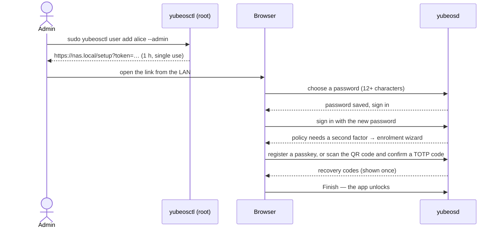
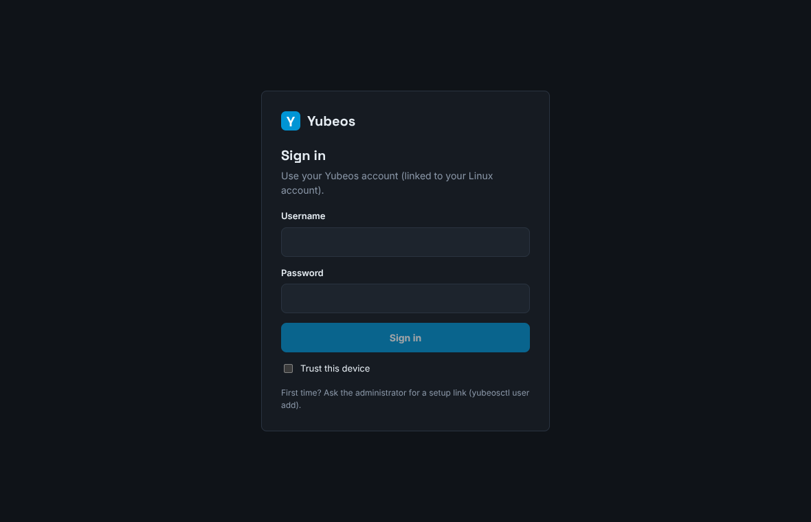
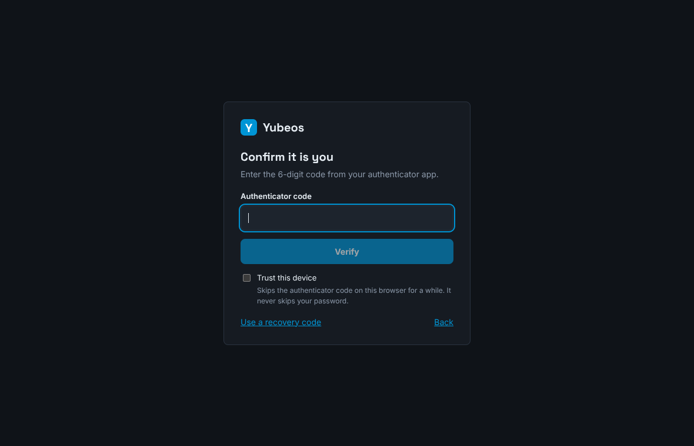
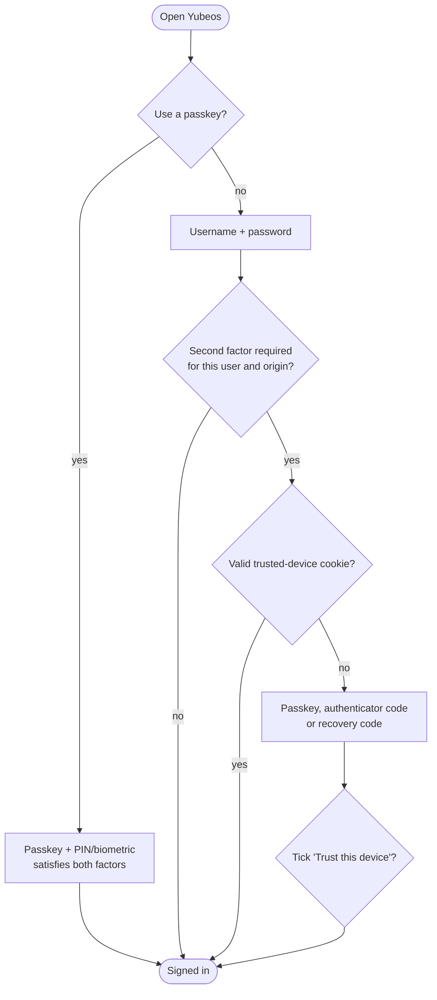
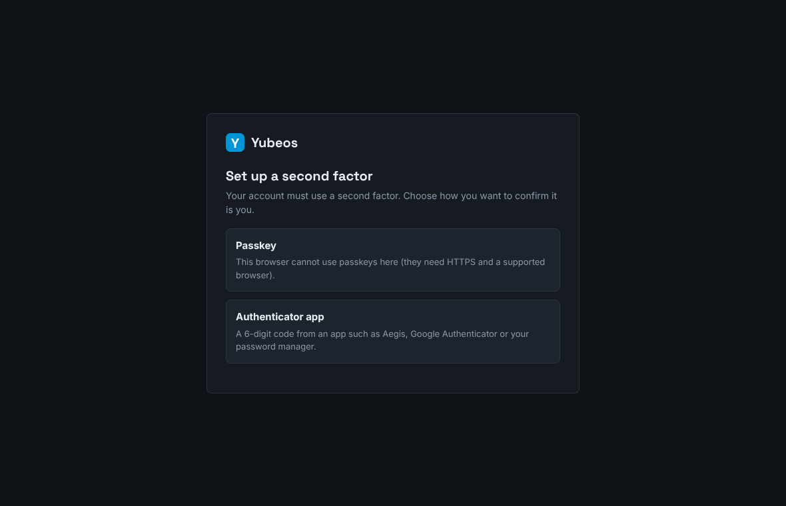
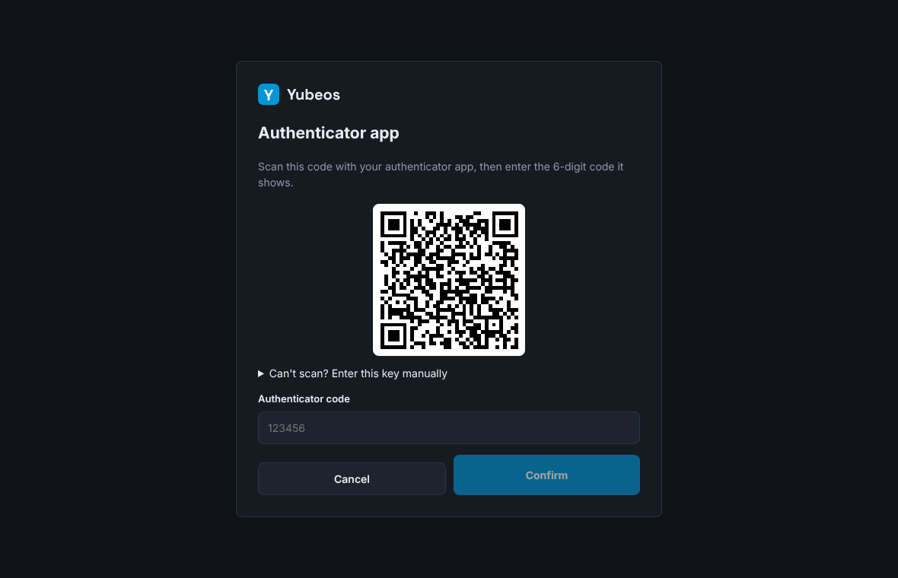
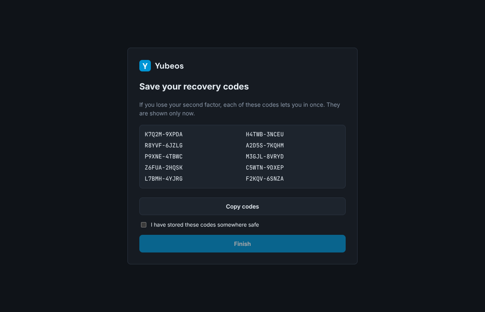
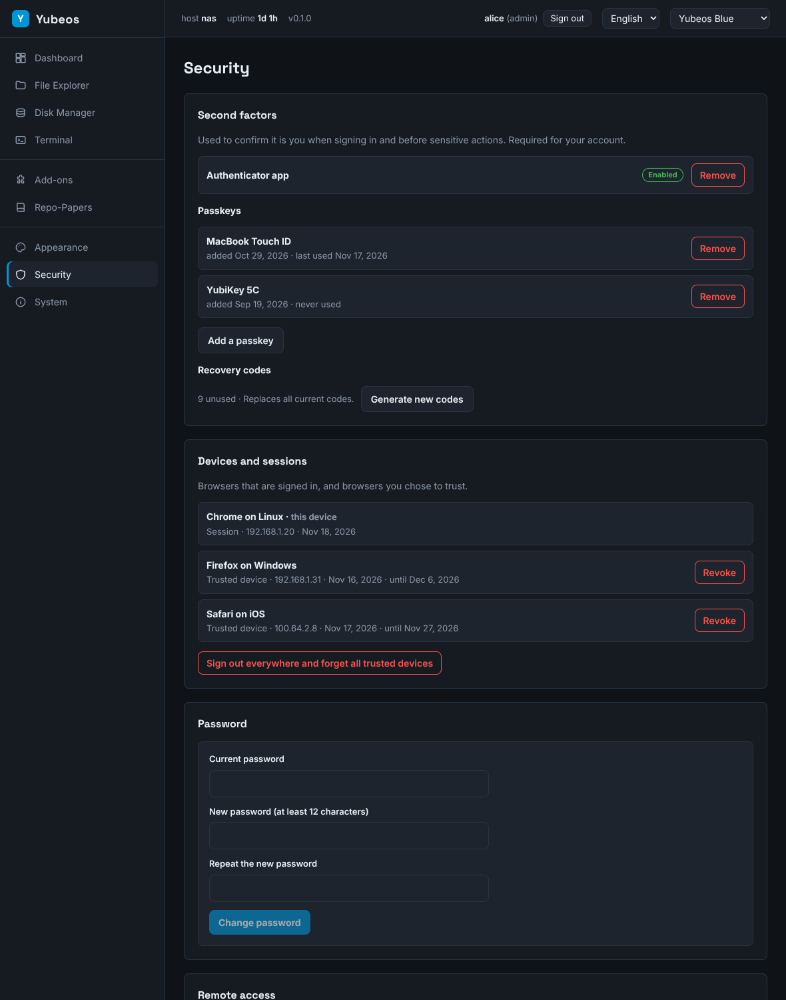
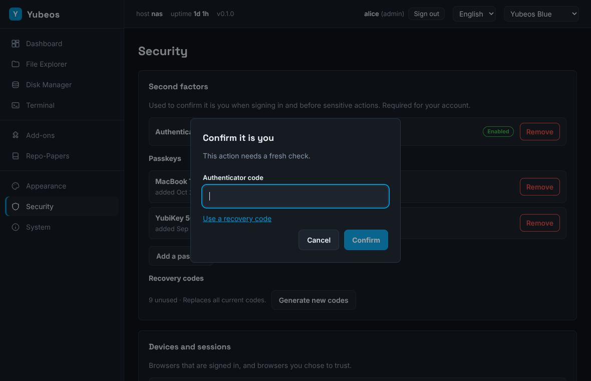

# 3. First login and second factors ✅

> **Status:** the sign-in flows below are implemented (Phase 1a–1e). Packaging (`.deb`, `apt`) arrives in Phase 9, so for now you build and install by hand ([Deployment](../DEPLOYMENT.md)). Design details: [Authentication](../AUTHENTICATION.md). Remaining confirmations on the real toolchain are tracked in [TD-024](../engineering/TECH-DEBT.md).

## 3.1 What you need

- Ubuntu Server 24.04 LTS (primary) or Debian 13, x86_64.
- Optional but recommended: OpenZFS, Samba/NFS, Docker Engine + Compose v2. Yubeos starts without them and greys out the matching sections.

## 3.2 Install (manual, until packages exist)

```bash
make deps && make build                       # dist/yubeosd, dist/yubeosctl, dist/yubeos-priv
sudo systemd-sysusers packaging/sysusers.d/yubeos.conf
sudo install -m0755 dist/yubeosd dist/yubeosctl /usr/bin/
sudo install -D -m0755 dist/yubeos-priv /usr/libexec/yubeos/yubeos-priv
sudo install -m0644 packaging/systemd/*.service /etc/systemd/system/
sudo install -D -m0644 packaging/config/config.example.yaml /etc/yubeos/config.yaml
sudo systemctl daemon-reload && sudo systemctl enable --now yubeos-priv yubeosd
sudo yubeosctl doctor                         # services, permissions, capabilities
```

The first start generates the TLS certificate and keys, creates the databases and prints the URL plus the certificate fingerprint. **There is no default password.**

## 3.3 Create the first administrator

```bash
sudo groupadd -f yubeos-admin
sudo usermod -aG yubeos-admin <your-linux-user>
sudo yubeosctl user add <your-linux-user> --admin
# prints a one-time setup link (valid 1 hour, single use, honoured only from a local network address)
```



Passwords are stored as Argon2id hashes inside the root helper; the network-facing process never sees the credential store.

## 3.4 Signing in



The sign-in page offers **Sign in with a passkey** (when your browser supports it over HTTPS) or **username + password**. If a second factor is needed you land on the confirmation step:





| Method | Notes |
|---|---|
| **Passkey** | Recommended. Phishing-resistant, no password typed. Bound to the hostname you enrolled on; changing the hostname means re-enrolling. Needs HTTPS with a name browsers accept. Alone it satisfies both factors unless `auth.allowPasskeyAsSoleFactor` is `false`. |
| **Password + TOTP** | Standard 6-digit, 30-second codes (Aegis, Google Authenticator, Bitwarden, 1Password…). Active only after you confirm a first code. Each code works once. |
| **Recovery codes** | Ten codes shown once at enrolment; each works once. Regenerate them from Security (needs step-up). |

### Two-factor policy

`auth.require2fa` is `none`, `admins` (default) or `all`. Regardless of the setting, **a login from outside your local network always needs a second factor**. An account with no second factor can sign in only from the local network, and only to enrol one (the wizard below).

### Enrolment wizard



New to passkeys or authenticator apps? [Chapter 8](08-passkeys-and-totp.md) explains what they are and how to use them.

Passkey creation asks for a name and then your device's prompt (fingerprint, face, PIN or security key). The authenticator-app path shows a QR code and a manual key:



After the first code is confirmed you get your recovery codes. The **Finish** button stays disabled until you tick that you stored them:



### Trusted devices

Tick **Trust this device** while confirming a second factor to skip the *authenticator-code prompt* on that browser for `auth.trustedDeviceDays` (default 30). Important details:

- It never skips the password and never replaces step-up confirmation.
- The device token is **rotated on every use**. Presenting an old token after a short grace window is treated as theft: the device and its sessions are revoked and an alert is logged.
- The device is bound to the browser family and operating system; a different browser is simply asked for the code.
- The lifetime counts from your last real second-factor check, not from last use.
- Admins signing in remotely are capped at `auth.adminRemoteTrustedDeviceDays` (default 14).
- Changing your password, removing a second factor or using a recovery code forgets all trusted devices.
- Set `trustedDeviceDays: 0` to disable the feature.

### Managing factors, devices and sessions

**Settings → Security** lists everything and lets you act on it:



| Card | What you can do |
|---|---|
| **Second factors** | Set up or remove the authenticator app, add or remove passkeys (a passkey that showed signs of cloning is marked *blocked*), generate new recovery codes. |
| **Devices and sessions** | See every signed-in session and trusted device with address and dates, revoke one, or sign out everywhere. |
| **Password** | Change your password (other sessions and trusted devices are signed out). |
| **Remote access** (admins) | Readiness checklist and the lockdown switch, see [chapter 4](04-remote-access.md). |

### Step-up confirmation

Sensitive actions (removing a factor, generating recovery codes, switching lockdown) ask you to confirm it is you again, even though you are signed in:



Confirming opens a **5-minute window** and the action is retried automatically. A trusted device can never satisfy step-up. An account with no second factor confirms with its password instead.

## 3.5 Lost password or second factor

There is deliberately no email recovery. Use a recovery code; otherwise, with root on the host:

```bash
sudo yubeosctl user reset <user>          # new setup link; revokes sessions and trusted devices
sudo yubeosctl user reset <user> --2fa    # removes TOTP, passkeys and trusted devices; user re-enrols from the LAN
```

Being root on the machine is the root of trust. Disabling or removing the Linux account revokes access within five minutes.

## 3.6 Brute-force protection

After `auth.lockoutThreshold` failures (default 10) an account is locked for `auth.lockoutMinutes` (default 15). Wrong second-factor codes count as failures too. Remote origins also get escalating per-IP bans; a fail2ban filter ships with the package. A global cool-down across all addresses is not implemented yet ([TD-018](../engineering/TECH-DEBT.md)). See [Authentication §8](../AUTHENTICATION.md#8-brute-force-and-abuse-protection).

Next: [4. Remote access](04-remote-access.md).
