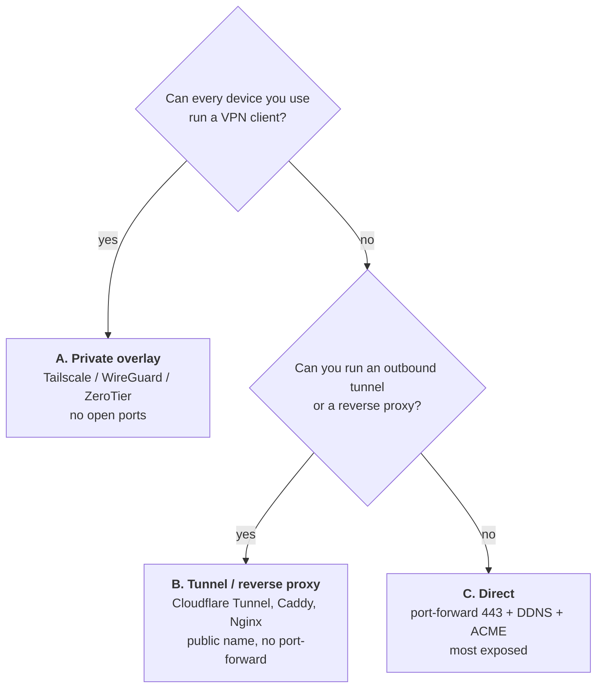
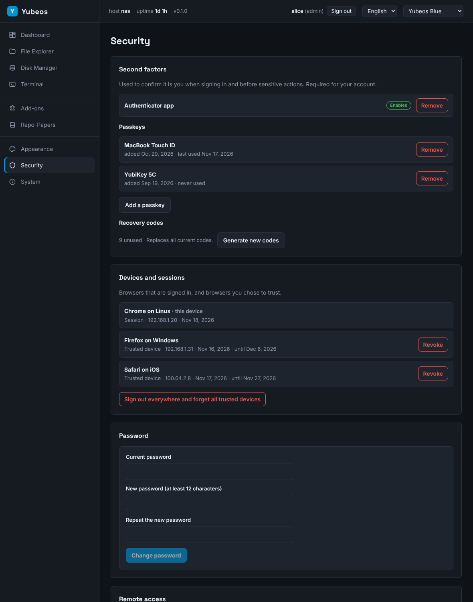

# 4. Remote access ✅

> **Status:** implemented in Phase 1d (built-in ACME, lockdown, readiness checklist, `doctor --remote`); ACME has not yet been exercised against Let’s Encrypt ([TD-024](../engineering/TECH-DEBT.md)). A global login cool-down across all addresses is still missing ([TD-018](../engineering/TECH-DEBT.md)).

Yubeos manages disks, files, containers and a shell, so an internet-exposed instance is a high-value target. It supports remote access properly (mandatory 2FA, trusted TLS, brute-force defences, device management, audit), but the safest design is still **not** to publish the login page to the whole internet. Full design: [Remote access](../REMOTE-ACCESS.md).

## 4.1 Pick an option



| Option | Exposure | Config sketch |
|---|---|---|
| **A. Overlay** | None to the internet | Keep `server.exposure: lan`. Overlay addresses (100.64.0.0/10) count as *local* by default. |
| **B. Tunnel / proxy** | Public hostname | `exposure: remote`, `behindProxy: true`, `trustedProxies`, `allowedHosts` |
| **C. Direct** | Public hostname + open port | `exposure: remote`, `tls.mode: acme`, `allowedHosts` |

## 4.2 Examples

> **Reverse proxies must forward WebSockets.** The Dashboard (and later the Terminal) use `/ws/…`. Caddy does this automatically; for Nginx add `proxy_http_version 1.1; proxy_set_header Upgrade $http_upgrade; proxy_set_header Connection "upgrade";` to the location, and keep the original `Host` (`proxy_set_header Host $host;`) because WebSockets are accepted only when the browser's `Origin` matches the host. Cloudflare Tunnel supports WebSockets by default.

**Option B** — proxy on the same host (`/etc/yubeos/config.yaml`):

```yaml
server:
  exposure: remote
  listen: 127.0.0.1:8443
  behindProxy: true
  trustedProxies: ["127.0.0.1"]
  allowedHosts: ["nas.example.org"]
auth:
  mode: native
  require2fa: all
```

**Option C** — Yubeos terminates TLS with a Let’s Encrypt certificate (needs ports 443 and 80 reachable from the internet):

```yaml
server:
  exposure: remote
  listen: ":443"
  httpRedirect: ":80"
  allowedHosts: ["nas.example.org"]
  tls:
    mode: acme
    acmeDomains: ["nas.example.org"]
    acmeEmail: me@example.org
auth:
  mode: native
  require2fa: all
  trustedDeviceDays: 30
```

With `acme`, certificates are obtained on first use (TLS-ALPN-01 on the HTTPS port, HTTP-01 on the port-80 listener), cached under the state directory and renewed automatically. `acmeDomains` is mandatory and `acme` cannot be combined with `behindProxy`.

## 4.3 The safety net

With `server.exposure: remote`, `yubeosd` **refuses to start** unless all of these hold:

1. `allowedHosts` is set (defeats DNS-rebinding and Host-header attacks).
2. The certificate is trusted by browsers (`tls.mode` is `files` or `acme`) — or `behindProxy: true` with `trustedProxies`.
3. `auth.mode` is `native` (no system passwords on the internet).
4. `auth.require2fa` is `all`.
5. `auth.allowRoot` is `false`.

These rules are enforced by the configuration loader. At runtime the remote stack adds HSTS, escalating per-IP bans, origin classification, `access.allowCidrs` and the lockdown switch below.

## 4.4 Local versus remote origin

| Policy | Local origin | Remote origin |
|---|---|---|
| Second factor at login | per `auth.require2fa` | always |
| Account without 2FA | may sign in only to enrol | refused |
| Idle timeout | 30 min | 15 min |
| Terminal and destructive actions | step-up only for destructive | step-up for both |
| IP bans | never | yes |

“Local” means loopback, private ranges and, by default, the Tailscale/CGNAT range. The client address is the TCP peer unless that peer is listed in `trustedProxies`.

## 4.5 Readiness checklist and lockdown

Administrators see a **Remote access** card on **Settings → Security**. Each line is a check from §4.3 (allowed hosts, trusted certificate, native auth, second factor for everyone, no root login, proxy trust); gaps show as warnings while you are still on `exposure: lan` and as failures when `exposure: remote`.



The same information is available on the server:

```bash
sudo yubeosctl doctor --remote      # config checks incl. exposure, TLS, 2FA policy, lockdown
sudo yubeosctl status               # version, exposure, lockdown, helper reachability
```

**Lockdown** is the emergency brake: while it is on, every request from a *remote* origin is refused with HTTP 503, while the local network (and overlay addresses treated as local) keeps working.

```bash
sudo yubeosctl lockdown on          # or: Settings → Security → Enable lockdown (asks for step-up)
sudo yubeosctl lockdown status
sudo yubeosctl lockdown off
```

## 4.6 Network checklist

- Forward **only** 443 (and 80 if you use ACME/HTTP-01 or the redirect). Never SSH, SMB (445/139), NFS, Docker or add-on ports (20000–29999).
- Keep OS security updates automatic.
- Optionally add an independent gate (Cloudflare Access, an OIDC proxy) in front of option B.
- Run `sudo yubeosctl doctor --remote` after every change, and switch lockdown on if anything looks wrong.

Next: [5. Sections tour](05-sections-tour.md).
