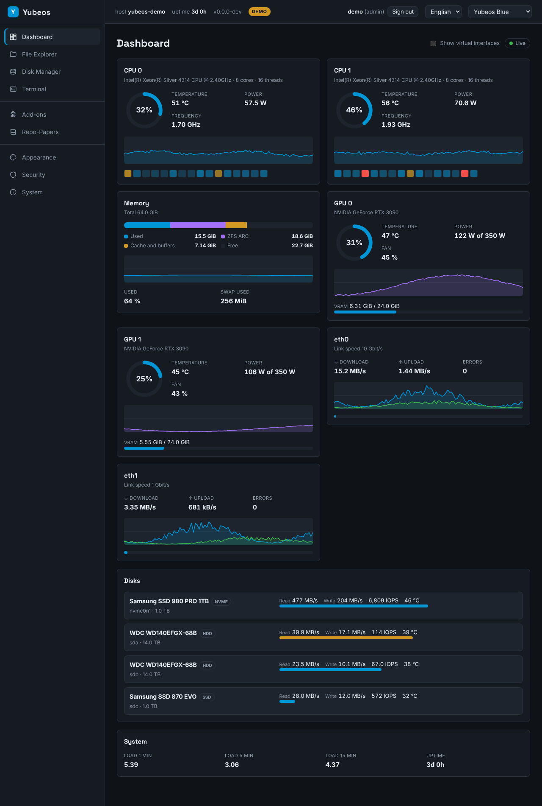
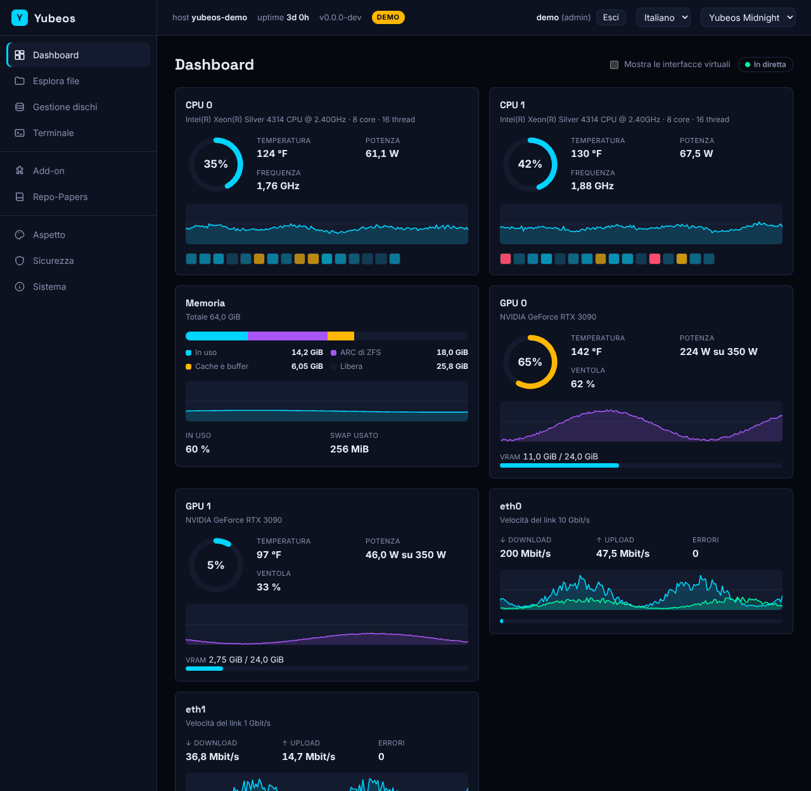
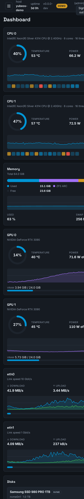
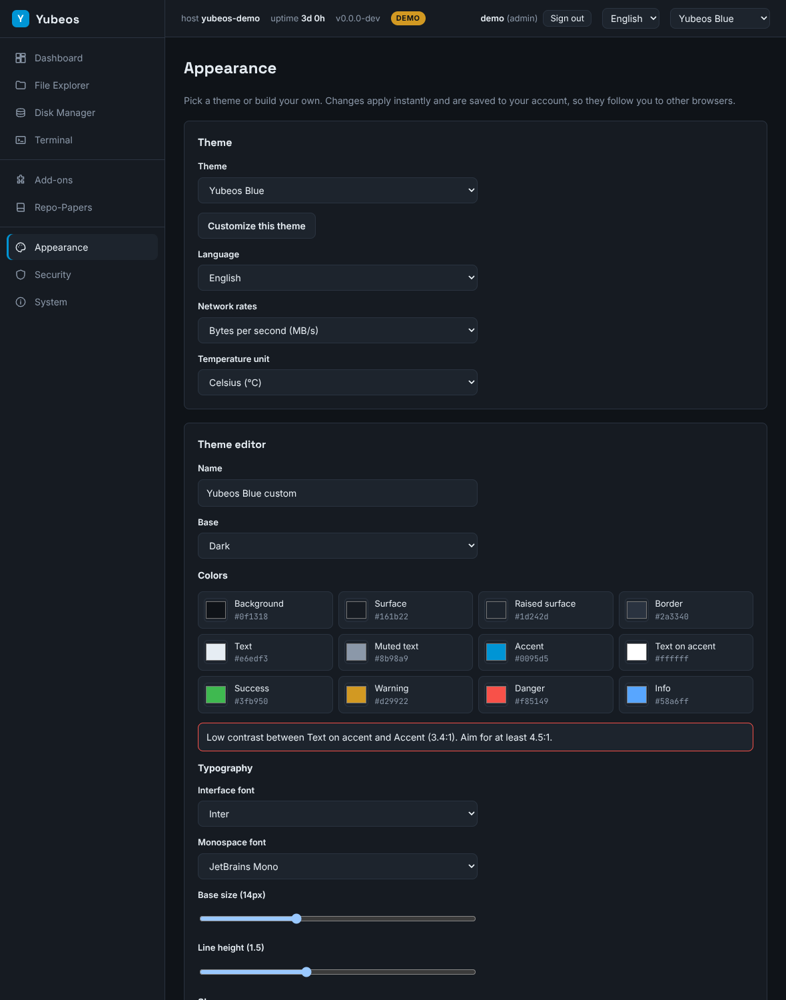
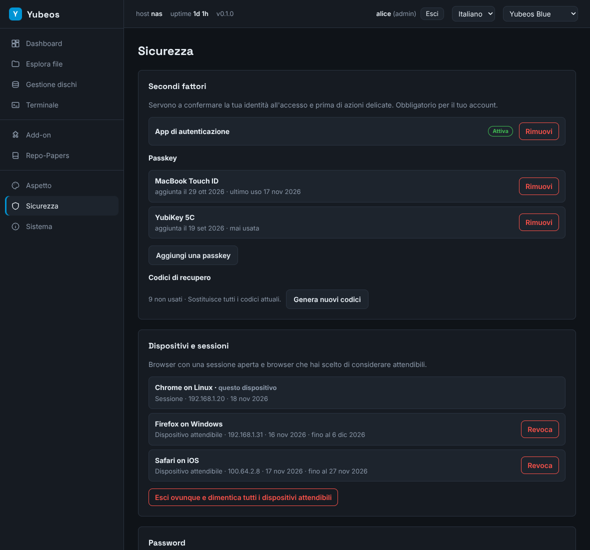

# 5. Sections tour

Each section has a module specification in [`docs/modules/`](../modules/). This page summarises what you will be able to do and when. The navigation, theming and routing for every section exist today ✅; the pages themselves show a placeholder until their phase.

| Section | Phase | Roles | Status |
|---|---|---|---|
| [Dashboard](#dashboard) | 2 | user, admin | ✅ |
| [File Explorer](#file-explorer) | 4 | user, admin | 🟦 |
| [Disk Manager](#disk-manager) | 5–6 | admin | 🟦 |
| [Terminal](#terminal) | 3 | admin (users if enabled) | 🟦 |
| [Add-ons](#add-ons) | 7 | browse: all · change: admin | 🟦 |
| [Repo-Papers](#repo-papers) | 8 | user, admin | 🟦 |
| [Appearance](#appearance) | 1 | everyone (per browser) | ✅ |
| [Security](#security) | 1 | user, admin | ✅ |

## Dashboard ✅

*Spec: [dashboard](../modules/dashboard.md)*

Live cards, refreshed about once per second over a WebSocket (the top-right pill says **Live**, **Reconnecting…** or **Updating every 2 s** when it fell back to polling):

- **CPU (one card per socket):** model, cores and threads, utilisation gauge, temperature, package power and frequency, a five-minute chart and a **heat grid with one cell per thread** (blue → amber → red as the load rises; hover for the exact value).
- **Memory:** a stacked bar of *Used*, *ZFS ARC*, *Cache and buffers* and *Free* (the ARC is shown separately because the operating system does not count it as cache), a usage chart and swap.
- **GPU (one card per NVIDIA card):** utilisation, temperature, power against its limit, fan, and VRAM bar.
- **Network (one card per interface):** download/upload rates, link speed and how much of it is used, errors. Virtual interfaces (`lo`, `docker0`, `veth…`) are hidden until you tick **Show virtual interfaces**.
- **Disks:** model, device name, type (HDD/SSD/NVMe), capacity, read/write rate, IOPS, busy bar and temperature.
- **System:** load averages and uptime.

If a source is unavailable the card says why instead of staying empty (for example “rapl: RAPL requires the privileged helper”), and a card whose data stops arriving is dimmed. Other sources keep working.

**Units:** in **Appearance** choose bytes per second (MB/s) or bits per second (Mbit/s) and °C or °F; the choice is saved to your account.

On a phone the cards stack into a single column:

**Where the data comes from (real hardware):** `/proc` and `/sys` for CPU, memory, network, disks and load; one long-lived `nvidia-smi` for NVIDIA GPUs; the privileged helper for CPU package power (RAPL counters are root-only). Disk temperatures need the kernel's `drivetemp` module for SATA drives ([TD-033](../engineering/TECH-DEBT.md)). History: the last hour is kept in memory and per-minute averages for 30 days in the database; the screen charts the last five minutes for now ([TD-034](../engineering/TECH-DEBT.md)).

## File Explorer

*Spec: [files](../modules/files.md)*

A breadcrumb bar and a table (Name, Date, Type, Size) with expandable folder rows, multi-select, drag-and-drop upload with a progress queue, and download (folders and multi-selections stream as a ZIP). Operations run **as the requesting Linux user**, so ordinary file permissions apply; browsing is limited to the roots in `files.roots` (default `/mnt`).

## Disk Manager

*Spec: [storage](../modules/storage.md)*

1. **Disks:** inventory with stable identity, editable alias and tags, SMART health, utilisation.
2. **Pools:** read-only ZFS pool and vdev view first, then plan-and-confirm pool creation, scrub and replace.
3. **Datasets and snapshots:** CRUD, quotas, snapshot policies, rollback.
4. **Sharing:** SMB/NFS shares bound to datasets, rendered into Yubeos-owned include files.

Safety rule: boot and in-use disks are never touched; destructive actions require a reviewed plan and step-up confirmation.

## Terminal

*Spec: [terminal](../modules/terminal.md)*

Multiple tabs, each a real login-like shell for your Linux user (correct `HOME`, groups, `sudo` works), powered by xterm.js. Sessions survive page reloads: the server keeps the PTY alive and replays recent output when you reattach. From a remote origin, opening a terminal asks for step-up confirmation.

## Add-ons

*Spec: [addons](../modules/addons.md)*

An add-on is a Docker Compose application plus a small `addon.yaml` manifest (validated by [`schemas/addon.schema.json`](../../schemas/addon.schema.json)). Yubeos adds a catalogue, a generated configuration form, dataset-backed storage mapping, port-conflict detection, lifecycle jobs and an authenticated reverse proxy. Each installed add-on gets its own sidebar entry that opens inside the shell. Add-on host ports are allocated from `addons.portRange` (default 20000–29999) and are LAN-only by default.

## Repo-Papers

*Spec: [repo-papers](../modules/repo-papers.md)*

Two views: **Repos** (the best repositories of the last 7/30/90/180 days, ranked by stars *and* growth) and **Papers** (important or widely discussed papers from reliable sources), both filterable by topic. Topics are saved queries (GitHub topics, keywords, languages, arXiv categories, minimum stars). Sources are configurable in `repopapers.sources`; an optional GitHub token (`repopapers.githubTokenFile`) raises rate limits.

## Appearance ✅

*Spec: [appearance](../modules/appearance.md)*

Pick **Yubeos Blue, Light or Midnight** (or follow the system setting), choose the interface language (English / Italiano), or press **Customize this theme** to open the editor:

- **Colours:** twelve tokens (background, surfaces, border, text, muted text, accent, text on accent, success, warning, danger, info). The editor warns when contrast drops below 4.5:1.
- **Typography:** interface and monospace fonts, base size 12–18 px, line height.
- **Shape:** corner radius and density.
- **Units:** network rates in bytes or bits per second, temperature in °C or °F.
- **Preview:** shown live inside the editor; **Save theme** applies it everywhere and adds it to your theme list.
- **Export / import:** themes are plain JSON validated with the same rules as [`schemas/theme.schema.json`](../../schemas/theme.schema.json); an invalid import lists exactly what is wrong.

Theme, custom themes, language and units are **saved to your account** and follow you to other browsers ([ADR-0020](../adr/0020-user-preferences.md)); the first time you sign in on a server with nothing saved, the settings already in your browser are uploaded. Design rule: components use only `var(--y-*)` tokens, enforced by `scripts/check-raw-colors.mjs` in `make lint`.

## Security ✅

*Specs: [authentication](../AUTHENTICATION.md), [remote access](../REMOTE-ACCESS.md)*

Second factors (authenticator app, passkeys, recovery codes), devices and sessions, password change, and for administrators the remote-access checklist and lockdown switch, all in one page. See chapters [3](03-install-and-first-login.md#managing-factors-devices-and-sessions) and [4](04-remote-access.md#45-readiness-checklist-and-lockdown).

Next: [6. Commands and configuration reference](06-reference.md).
