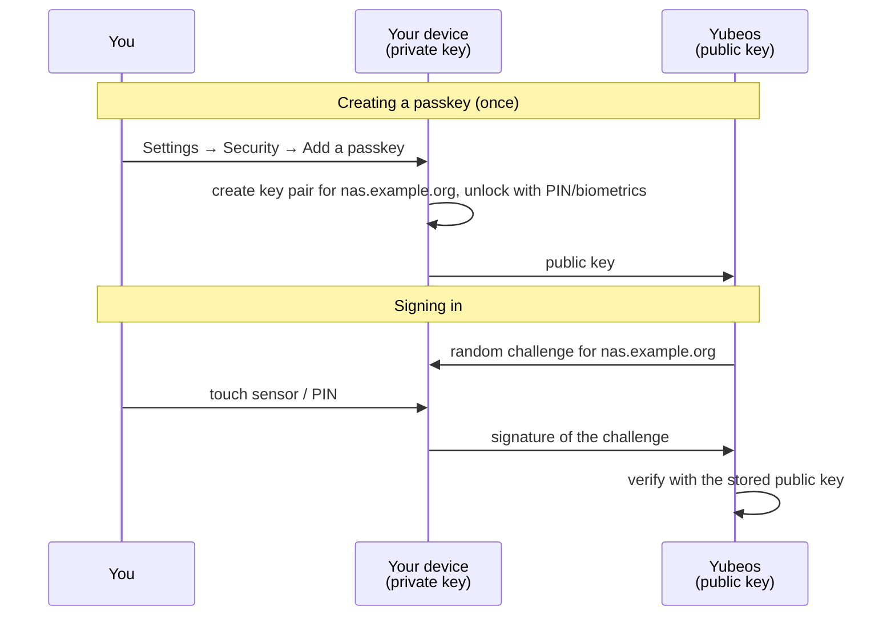
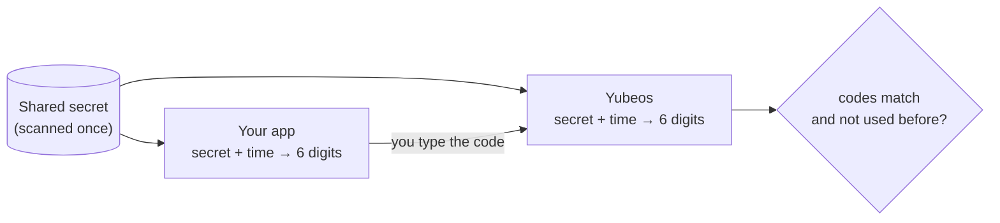
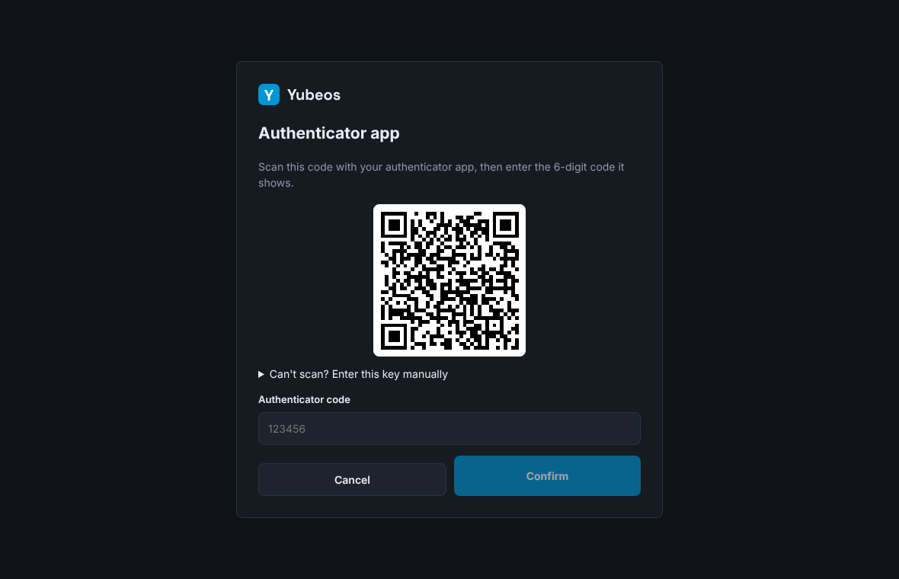

# 8. Passkeys and authenticator apps explained ✅

Yubeos asks for a **second factor** besides your password when the policy says so (`auth.require2fa`) and **always** when you sign in from outside your local network. This chapter explains the two kinds of second factor it supports, what they protect you from, and how to use them day to day.

## 8.1 Why a second factor at all

A password can be guessed, reused from a leaked site, or phished. A second factor proves something a thief does not have: **your device**. Yubeos can manage disks, files and a shell, so a stolen password must not be enough.

| | Passkey | Authenticator app (TOTP) |
|---|---|---|
| What you do | Touch a sensor / enter a device PIN | Type a 6-digit code |
| Phishing resistant | **Yes** (works only on the real address) | No (a fake page can ask for the code) |
| Works offline | Yes | Yes |
| Needs HTTPS | **Yes** | No |
| Typical storage | Phone, laptop, security key, password manager | Phone app, password manager |
| Best for | Daily use | Backup, or browsers/devices without passkeys |

Recommended: **one passkey per computer or phone you use, one hardware security key kept somewhere safe, an authenticator app as backup, and the recovery codes printed or in a password manager.**

## 8.2 Passkeys

### What they are

A passkey is a **pair of cryptographic keys** created for one website address. The **private key never leaves your device** (or your security key or password manager); Yubeos stores only the **public key**. To sign in, Yubeos sends a random challenge, your device signs it after you unlock it with a fingerprint, face or PIN, and Yubeos checks the signature.

Why it is safe:

- **Bound to the address.** The browser only offers the passkey to the exact hostname it was created for, so a look-alike phishing site gets nothing to sign.
- **Nothing secret travels.** There is no code or password to intercept or replay.
- **Clone detection.** Each use increments a counter inside the authenticator. If Yubeos ever sees the counter go backwards (a copied key), it **blocks that passkey** and shows “blocked: possible clone” in Security.

### What Yubeos supports

Passkeys created by platform authenticators (Touch ID, Windows Hello, Android), FIDO2 security keys (YubiKey and similar) and password managers, using the common **ES256** algorithm. User verification (PIN or biometrics) is always required. Up to 10 passkeys per account. A passkey can be used **alone** (it counts as password *and* second factor) or after the password; set `auth.allowPasskeyAsSoleFactor: false` to always require the password too.

### How to create one

1. Sign in, open **Settings → Security**, press **Add a passkey** (during first-time enrolment it is the recommended choice in the wizard).
2. Give it a recognisable name (“Work laptop”, “YubiKey 5C”).
3. Your browser or system shows its own prompt: touch the sensor, enter the PIN or insert and tap the key.
4. The passkey appears in the list with its creation date. Repeat on every device you use, and once for a hardware key.

### How to use it

- On the sign-in page press **Sign in with a passkey** and confirm on your device. No username or password needed.
- Or enter your password first; if a second factor is required, choose **Use a passkey instead**.

### Things to know

- **HTTPS is required** (browsers refuse passkeys on plain HTTP except `localhost`).
- **A passkey belongs to a hostname.** If you reach Yubeos as `nas.lan` at home and `nas.example.org` remotely, create a passkey on each name (or use the same name everywhere). Changing the hostname later means re-enrolling.
- **Lost or stolen device:** sign in with another passkey, the authenticator app or a recovery code, then remove the lost passkey in Security (it asks for a fresh confirmation, see [step-up](03-install-and-first-login.md#step-up-confirmation)). If nothing is left, an administrator runs `sudo yubeosctl user reset <user> --2fa` on the server.
- **Synced passkeys** (password managers, platform clouds) are convenient; a **security key** is the strongest because the key can never be copied.

## 8.3 Authenticator apps (TOTP)

### What it is

TOTP (*time-based one-time password*, RFC 6238) shows a **6-digit code that changes every 30 seconds**. Yubeos and your app share a secret once, when you scan the QR code; afterwards both compute the same code from that secret and the current time. No network connection is needed on the phone.

### Setting it up

1. Install an authenticator app: **Aegis** (Android), **2FAS**, **Google Authenticator**, **Microsoft Authenticator**, **Bitwarden**, **1Password**, **KeePassXC**… any RFC 6238 app works.
2. In **Settings → Security** press **Set up** next to *Authenticator app* (or choose it in the enrolment wizard).
3. Scan the QR code with the app. If you cannot scan, open *Can't scan?* and type the key by hand.
4. Type the 6-digit code the app shows and press **Confirm**.
5. **Save the ten recovery codes** that appear (they are shown only once).

### Using it

Sign in with your password; when asked, type the current code. Tick **Trust this device** to skip the code on that browser for a while (never the password). Each code works **once**: if you just used it, wait for the next one.

### Things to know

- **Keep the phone's clock correct** (automatic time). Yubeos accepts the code of the previous, current and next 30-second step, so a few seconds of drift are fine, minutes are not.
- **The secret is stored encrypted on the server** (AES-256-GCM, key kept in the root-only helper directory) and is never shown again after enrolment. To move to a new phone, remove the factor in Security and set it up again, or export/restore your app's own backup.
- **Phishing:** a fake page could ask for your code and relay it in real time. This is why passkeys are preferred for daily use and why Yubeos never skips the password on trusted devices.

### Recovery codes

Ten single-use codes created when TOTP is enabled. Use one at the second-factor prompt (**Use a recovery code**) if you lost your phone and have no other factor. Using one also forgets all trusted devices. Store them offline (printed, or in a password manager) and **generate new ones** from Security when few are left; generating new codes invalidates the old ones.

## 8.4 Quick answers

| Question | Answer |
|---|---|
| Do I need both? | No. One passkey **or** an authenticator app satisfies the policy. Having both plus recovery codes is the safest. |
| Can I use a passkey on my phone to sign in on my laptop? | Yes, if your browser/OS offers cross-device passkeys (QR prompt); otherwise create one on the laptop. |
| Why am I asked again after signing in? | Sensitive actions need a fresh confirmation (5-minute window). A trusted device never satisfies it. |
| I only have remote access and no second factor. | Remote sign-in is refused without a second factor. Enrol it from the local network first. |
| Where are my factors managed? | **Settings → Security** → *Second factors*. |

Back to [3. First login and second factors](03-install-and-first-login.md) · [Troubleshooting](07-troubleshooting.md).
