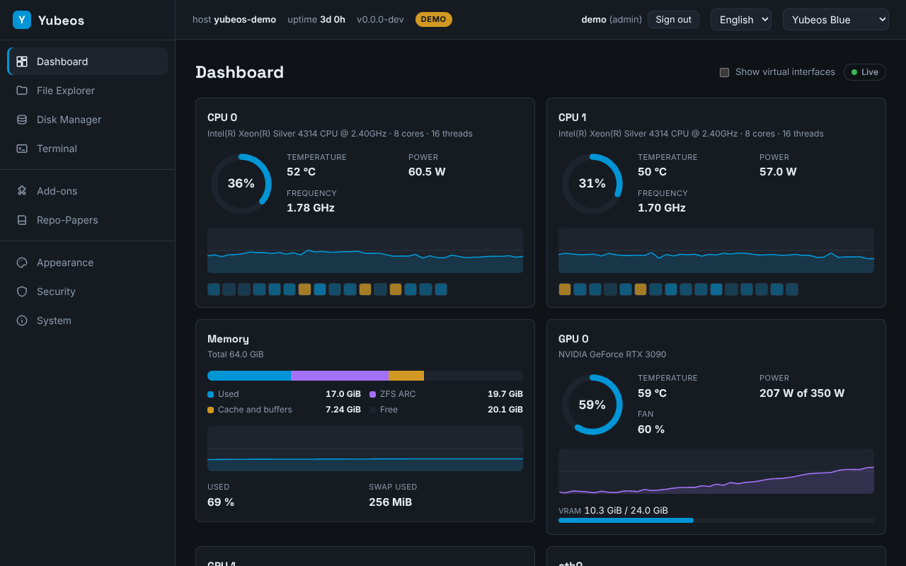

# Yubeos Tutorial

A guided tour of Yubeos: what it is, how the pieces fit together, how to run it, and how to use each section. The reference documentation ([Architecture](../ARCHITECTURE.md), [Security](../SECURITY.md), [API](../API.md)…) explains *why*; this tutorial explains *how*.



## Reading order

| # | Chapter | You will learn |
|---|---|---|
| 1 | [How it works](01-how-it-works.md) | Components, privilege boundary, request flow, data ownership |
| 2 | [Try the demo](02-try-the-demo.md) | Run Yubeos on a laptop in two commands, tour the shell, themes, mobile layout, hot-reload dev loop |
| 3 | [Install and first login](03-install-and-first-login.md) | Create the first admin, passwords, TOTP, passkeys, recovery codes, trusted devices, step-up |
| 4 | [Remote access](04-remote-access.md) | Reach the NAS from outside: VPN, tunnel or direct, with the safety rules Yubeos enforces |
| 5 | [Sections tour](05-sections-tour.md) | Dashboard, File Explorer, Disk Manager, Terminal, Add-ons, Repo-Papers, Appearance, Security |
| 6 | [Commands and configuration reference](06-reference.md) | `yubeosd` flags, `make` targets, `yubeosctl`, environment variables, every config key |
| 7 | [Troubleshooting and FAQ](07-troubleshooting.md) | Common problems and what to check |
| 8 | [Passkeys and authenticator apps explained](08-passkeys-and-totp.md) | What passkeys and TOTP are, how to set them up and use them, recovery |

## Status legend

Yubeos is built in phases ([Roadmap](../ROADMAP.md)). Every feature in this tutorial carries a badge so you know what you can run today.

| Badge | Meaning |
|---|---|
| ✅ **Available** | Implemented in this repository; you can try it now (`make demo`). |
| 🟦 **Specified** | Contract and design are written and reviewed; implementation lands in the phase shown. Commands and screens are documented as designed and may change before the phase ships. |

> **Where the project stands.** Phase 1 (sign-in, second factors, trusted devices, remote access, Appearance) and Phase 2 (Dashboard) are implemented and badged ✅. The web UI and the Go side are covered by automated tests (end-to-end API tests on the real helper and database); a few confirmations on the real toolchain remain ([TD-024](../engineering/TECH-DEBT.md)), so treat it as ready for review rather than released. Dashboard and shell screenshots come from a real `yubeosd --demo` instance; the sign-in, enrolment and Security screens come from the production web build with simulated API answers ([TD-030](../engineering/TECH-DEBT.md)).

## Five-minute path

```bash
git clone https://github.com/serpis172/Yubeos && cd Yubeos
make deps && make demo          # https://localhost:8443 — accept the self-signed certificate
```

Then read chapter 2. When you want a real server, continue with chapter 3.
